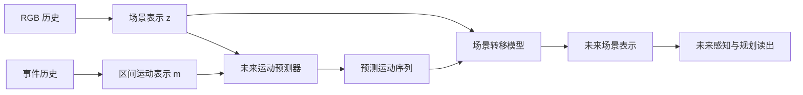

# Event–RGB 世界模型研究方案

## Story：从场景理解到动态过程预测

自动驾驶需要同时理解交通场景的空间结构与动态演化。跟车、路口让行、汇入和变道等任务，不仅取决于车辆、行人在哪里，也取决于它们正在怎样运动，以及这种运动将如何改变交通局面。当前位置相近的对象，可能具有不同的速度、方向和运动趋势，对应不同的未来。

本研究围绕一个问题展开：**如何利用事件流中的细粒度变化，形成能够预测并驱动场景演化的动态表示？**

我们构建面向驾驶的 Event–RGB latent world model：视觉预训练提供对象、道路结构与空间关系等场景知识，事件流提供观测区间内的动态证据；模型从历史中预测未来运动，再由预测运动推进未来场景表示。该模型定位为自动驾驶 WM/WAM 系统中的场景表征与动态预测模块，为未来感知和轨迹规划提供预测表示。

## Motivation：为什么需要事件动态表示

### 视觉预训练提供可复用的场景知识

[DINOv2](https://arxiv.org/abs/2304.07193) 通过大规模图像预训练获得可迁移的语义与空间特征，[DINO-Foresight](https://arxiv.org/abs/2412.11673) 在这些特征上学习未来演化。以此为基础，可以复用成熟的场景表示与预测框架，将研究重点放在事件动态信息的表达和利用上。

### 事件提供观测区间内的变化过程

RGB 历史能够支持运动推断，事件流则以亮度变化的位置、时间和极性记录更细粒度的过程。当运动在相邻帧之间发生变化时，事件的时间顺序和分布提供了额外的观测依据。其研究价值在于将这些变化与场景中的对象、空间关系和运动趋势联系起来。

### 未来预测需要保留动态过程的表示

以当前感知或单帧 RGB 特征对齐为目标，未必能充分保留影响未来演化的区间内变化。同一当前位置背后的接近速度、变化方向和近期趋势，需要在表示中得到区分。

因此，本研究以未来演化为学习目标，将事件动态组织成兼具**历史可预测性**与**场景转移有效性**的运动表示：既能从历史推断它将如何变化，也能通过它推进场景状态。研究目标是改善短时、多步预测，并提高模型在不同场景和运动条件下的泛化能力。

## Idea：预测运动，再推进场景

**以预训练 RGB 特征承载场景知识，以事件流编码区间运动过程，将未来运动作为场景推演的中间变量，联合学习运动预测与场景转移。**

场景表示与运动表示形成互补分工：前者提供对象和空间上下文，后者表达变化发生在哪里、以何种顺序发生，以及近期的运动趋势。未来运动预测结合两类历史信息，场景转移模型利用预测运动生成多个未来时刻的场景 latent。

## 方法设计

### 任务与输入输出

给定截至时刻 t 的 RGB 与事件历史，进行无动作条件的短时未来预测，输出固定预测间隔下的场景表示序列。运动表示描述场景中的观测动态。

| 部分 | 设计 |
|---|---|
| 输入 | RGB 历史、事件历史及其时间信息，观测均截止于 t |
| 历史表示 | RGB 场景特征序列 z 与事件区间运动表示序列 m |
| 预测中间变量 | 覆盖各个未来预测区间的运动表示 |
| 模型输出 | 多个未来时刻的场景 latent |
| 感知接口 | 从未来场景 latent 读出车辆、行人的位置与检测结果 |
| 规划接口 | 向规划模块提供当前与预测场景表示，结合自车状态和导航信息支持自车轨迹规划 |

### 场景与运动编码

**场景分支：**使用预训练 DINOv2 编码 RGB，形成包含对象语义、道路结构和空间关系的场景特征。RGB 历史保留时间信息，为运动预测提供上下文。

**事件分支：**将事件按连续子时间窗组织，编码为保留空间对应与时间顺序的运动 tokens。表示的学习目标是保留与未来演化相关的变化位置、方向、时间分布和趋势，使区间动态能够与场景特征中的对应区域建立联系。

两类表示围绕预测任务分工，联合利用场景内容与运动证据。事件运动表示由动态学习和场景转移目标约束，其表达空间保留单帧视觉对齐目标未必覆盖的时间信息。

### 未来运动预测与场景转移

运动预测器读取场景历史和运动历史，生成未来各区间的运动表示序列。场景转移模型以当前场景 latent 为起点，在每个预测步使用对应的预测运动更新状态，形成多步未来场景序列。

运动表示在模型中同时承担两项职责：作为预测目标，约束模型学习动态过程的演化；作为场景转移条件，将这种动态预测传递到未来场景。场景损失通过预测运动路径回传，使运动学习与最终预测任务相联系。

### 联合学习

训练以真实未来 RGB 的预训练特征和未来事件表示分别构造场景与运动监督。模型根据截至 t 的观测预测未来运动，并使用预测运动推进场景状态；未来 RGB、事件及标签用于目标构造和评价。

学习目标包含两个相互关联的部分：

- **运动预测目标：**约束预测运动表示与对应未来区间的事件动态表示一致，学习历史动态到未来动态的映射。
- **场景预测目标：**约束由预测运动推进得到的场景 latent 与真实未来 RGB 特征一致，使运动表示对场景转移有效。

推理沿用同一预测路径，由历史 RGB 和事件生成未来运动与场景表示。未来检测头读取预测 latent，输出车辆、行人的检测与位置结果。

## 预期 Novelty

**核心创新主张：利用事件的区间内动态信息，学习可预测、能驱动未来场景转移的运动表示。**

### 1. 面向未来演化的事件动态表示

将区间内变化的空间对应、时间顺序与分布纳入运动表示，以未来运动和场景演化为学习目标。设计重点是保留对预测有用的动态过程，使事件的时间信息在进入潜在空间后仍能参与未来推演。

### 2. 运动预测与场景转移的联合机制

将未来运动设为场景推演中的显式中间变量，通过运动预测与场景预测共同约束，连接“历史动态 → 未来动态 → 未来场景”。预测运动直接参与多步 rollout，场景转移误差反向约束运动学习，形成表示与预测之间的联系。

### 3. 面向驾驶的动态预测与泛化价值

研究事件动态表示对多步未来检测、定位和跨场景预测的贡献。在场景表示与模型资源相当的条件下，区分事件时间信息、运动预测机制与普通融合带来的作用，建立细粒度动态观测与未来任务收益之间的联系。

### 与相关工作的研究定位

| 相关工作 | 相关设计 | 本方案关注的问题 |
|---|---|---|
| [UniDynamics](https://arxiv.org/html/2610.03473v1) | 事件运动条件与未来 RGB、深度、光流预测 | 区间内时间结构如何形成对未来有用且可预测的运动表示 |
| [ECHO](https://arxiv.org/html/2609.34893v1) | 事件解释视觉特征变化，并学习未来事件 latent | 运动预测与场景转移如何共同约束同一条未来推演路径 |
| [Genie](https://arxiv.org/abs/2402.15391)／[LAPA](https://arxiv.org/html/2410.11758v1) | 从观测变化学习 latent action，用于世界模型转移或策略学习 | 事件区间内的时间信息能够为变化表示提供怎样的动态监督 |
| [Olaf-World](https://arxiv.org/html/2602.10104v2) | latent action 的跨场景一致性 | 如何学习跨场景可用、对运动演化敏感的动态表示 |

本研究的贡献集中在事件时间结构、可预测运动表示与场景转移学习三者的联系上，以具体的表示机制、联合学习方式和预测效果形成方法辨识度。
